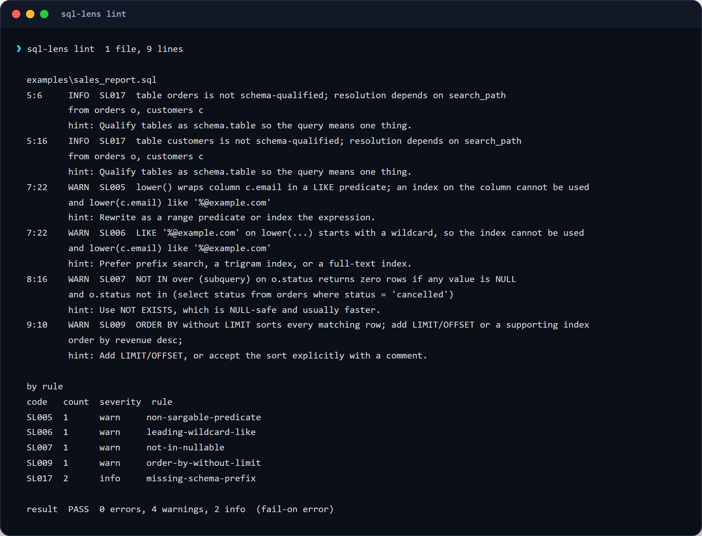
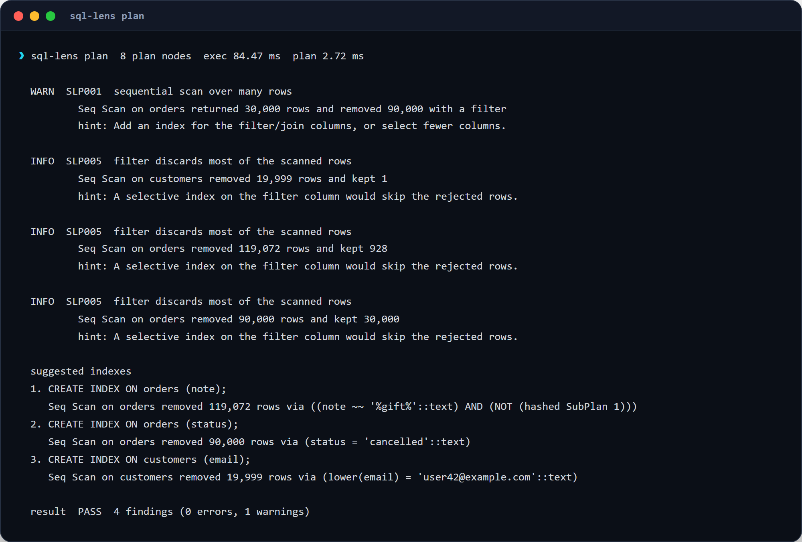
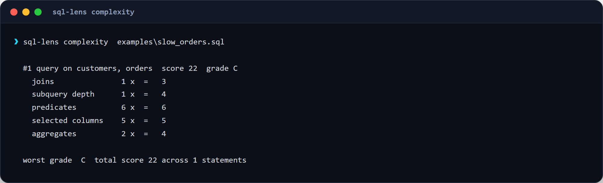
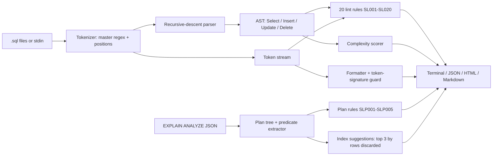

# sql-lens

**English** | [简体中文](README.zh-CN.md)

Static analysis for SQL that finds the slow, unsafe and unmaintainable query **before** it reaches production - and never needs a database connection.




## The problem

SQL is the only code most teams ship without a review step that can actually see it. A DELETE loses its WHERE during a refactor and takes the table with it. WHERE lower(email) = $1 silently disables the unique index the whole login path depends on. NOT IN (SELECT ...) starts returning zero rows the day a nullable column shows up. None of these are syntax errors, so the compiler, the ORM and the tests all stay quiet until production does not.

Database linters that could catch this need a live server, a schema dump, and an afternoon of setup - so they get skipped in CI. sql-lens takes a different bet: **parse the SQL yourself, model the planner rules, and check everything statically.** No connection string, no schema, no side effects. 20 rules, a real EXPLAIN-plan reader, a deterministic formatter and a complexity score, in one stdlib-only command.

## What it does

- **20 lint rules with stable codes (SL001-SL020)** covering correctness (DELETE without WHERE), performance (non-sargable predicates, leading-wildcard LIKE, NOT IN over nullable columns, cartesian products, unbounded ORDER BY) and maintainability (unused CTEs, hardcoded DML literals, mixed keyword casing, trailing commas). Each finding carries a file, line, column, the offending source line and a fix hint.
- **A from-scratch parser** - tokenizer plus recursive-descent parser - for a practical SQL subset: SELECT/INSERT/UPDATE/DELETE, CTEs (including RECURSIVE), joins, subqueries, set operations, window functions, CASE, casts, placeholders. DDL is preserved as a token stream so migration rules still work.
- **Five dialects**: PostgreSQL, MySQL, SQLite, SQL Server and ANSI, with their real quoting rules (double quotes, backticks, [brackets]), LIMIT vs TOP vs FETCH FIRST, LIMIT offset-count, :: casts, ILIKE, dollar-quoted strings and nested block comments.
- **EXPLAIN-plan diagnosis** - feed it the JSON that EXPLAIN (ANALYZE, FORMAT JSON) produces and it reports sequential scans over large tables, nested loops with huge row counts, row estimates off by more than 100x, and sorts that spilled to disk. It then prints the **top 3 CREATE INDEX statements** derived from the plan's own filter and join predicates, ranked by how many rows each filter discarded.
- **A deterministic formatter** with one fixed style: uppercase keywords, one clause per line, AND/OR at line starts, joins on their own line. It re-tokenizes its own output and **refuses to write anything whose token stream changed**, so it can never quietly corrupt a query. format(format(x)) == format(x) is enforced by tests on every bundled example.
- **Complexity scoring** per statement - joins, subquery depth, CTE count, predicate count, aggregates, window functions - mapped to an A-F maintainability grade with a per-signal breakdown.
- **Three report formats**: colour terminal output, --format json for tooling, self-contained --format html for a build artifact, plus Markdown tables for PR comments.
- **Documented exit codes**: 0 clean, 1 findings at or above --fail-on, 2 usage error. Broken SQL is reported as a parse error with a line and column, never as a traceback.

## Install

sql-lens is **not on PyPI yet**. Install from source; it takes about ten seconds:

```bash
git clone https://github.com/kele-tao/sql-lens
cd sql-lens
python -m pip install -e .
```

Python 3.10 or newer. **Zero runtime dependencies** - everything (tokenizer, parser, plan analysis, HTML renderer, terminal colours) is the standard library. The [dev] extra adds only pytest and ruff.

Or run it without installing:

```bash
python -m sql_lens lint examples/sales_report.sql
```

## Usage

### 1. Lint a directory of queries

```bash
$ sql-lens lint examples/sales_report.sql
sql-lens lint  1 file, 9 lines

  examples/sales_report.sql
  5:6     INFO  SL017  table orders is not schema-qualified; resolution depends on search_path
          from orders o, customers c
          hint: Qualify tables as schema.table so the query means one thing.
  7:22    WARN  SL005  lower() wraps column c.email in a LIKE predicate; an index on the column cannot be used
          and lower(c.email) like '%@example.com'
          hint: Rewrite as a range predicate or index the expression.
  7:22    WARN  SL006  LIKE '%@example.com' on lower(...) starts with a wildcard, so the index cannot be used
          hint: Prefer prefix search, a trigram index, or a full-text index.
  8:16    WARN  SL007  NOT IN over (subquery) on o.status returns zero rows if any value is NULL
          hint: Use NOT EXISTS, which is NULL-safe and usually faster.
  9:10    WARN  SL009  ORDER BY without LIMIT sorts every matching row; add LIMIT/OFFSET or a supporting index
          hint: Add LIMIT/OFFSET, or accept the sort explicitly with a comment.

  by rule
  code   count  severity  rule
  SL005  1      warn     non-sargable-predicate
  SL006  1      warn     leading-wildcard-like
  SL007  1      warn     not-in-nullable
  SL009  1      warn     order-by-without-limit
  SL017  2      info     missing-schema-prefix

  result  PASS  0 errors, 4 warnings, 2 info  (fail-on error)
```

Lint every example in the repo and the gate fails, because one of them is a DELETE-class mistake:

```bash
$ sql-lens lint examples/*.sql
...
  code   count  severity  rule
  SL002  1      error    missing-where-dml
  SL005  2      warn     non-sargable-predicate
  SL006  2      warn     leading-wildcard-like
  SL007  2      warn     not-in-nullable
  SL009  3      warn     order-by-without-limit
  SL013  1      warn     correlated-subquery
  SL015  2      warn     ddl-without-if-exists
  SL016  1      warn     unsafe-column-type-change
  SL017  4      info     missing-schema-prefix

  result  FAIL  1 error, 13 warnings, 4 info  (fail-on error)
$ echo $?
1
```

Useful flags: --dialect {postgres,mysql,sqlite,sqlserver,ansi}, --select SL005 SL007, --ignore SL017, --min-severity warning, --fail-on warning, --format {text,json,html,markdown}, -o report.html, --stdin, --no-color.

### 2. Diagnose a real query plan

The query lives in [examples/slow_orders.sql](examples/slow_orders.sql); the plan in [examples/explain_orders.json](examples/explain_orders.json) was captured from a real PostgreSQL instance (120,000 orders, 20,000 customers) by [benchmarks/make_plan_fixture.py](benchmarks/make_plan_fixture.py). No database is needed to analyse it:

```bash
$ sql-lens plan examples/explain_orders.json
sql-lens plan  8 plan nodes  exec 84.47 ms  plan 2.72 ms

  WARN  SLP001  sequential scan over many rows
          Seq Scan on orders returned 30,000 rows and removed 90,000 with a filter
          hint: Add an index for the filter/join columns, or select fewer columns.

  INFO  SLP005  filter discards most of the scanned rows
          Seq Scan on customers removed 19,999 rows and kept 1
          hint: A selective index on the filter column would skip the rejected rows.

  INFO  SLP005  filter discards most of the scanned rows
          Seq Scan on orders removed 119,072 rows and kept 928
          hint: A selective index on the filter column would skip the rejected rows.

  suggested indexes
  1. CREATE INDEX ON orders (note);
     Seq Scan on orders removed 119,072 rows via ((note ~~ '%gift%'::text) AND (NOT (hashed SubPlan 1)))
  2. CREATE INDEX ON orders (status);
     Seq Scan on orders removed 90,000 rows via (status = 'cancelled'::text)
  3. CREATE INDEX ON customers (email);
     Seq Scan on customers removed 19,999 rows via (lower(email) = 'user42@example.com'::text)

  result  PASS  4 findings (0 errors, 1 warnings)
```



Capture a plan the way PostgreSQL expects:

```bash
psql -A -t -c "EXPLAIN (ANALYZE, FORMAT JSON) SELECT ..." > plan.json
sql-lens plan plan.json --format json
```

--large-rows N tunes what counts as a large sequential scan (default 5000); --fail-on-any turns any finding into exit code 1 for CI.

### 3. Format and score

```bash
$ sql-lens format examples/sales_report.sql
-- Monthly revenue by country, used by the finance dashboard.
SELECT
  c.country,
  count(o.id) AS orders,
  sum(o.total_cents) AS revenue
FROM orders o, customers c
WHERE o.customer_id = c.id
  AND lower(c.email) LIKE '%@example.com'
  AND o.status NOT IN (
    SELECT status
    FROM orders
    WHERE status = 'cancelled'
  )
ORDER BY revenue DESC;
```

sql-lens format --check examples/ is a CI gate; --write rewrites in place. Then measure how hard the query is to maintain:

```bash
$ sql-lens complexity examples/slow_orders.sql
sql-lens complexity  examples/slow_orders.sql

  #1 query on customers, orders  score 22  grade C
    joins               1 x  =   3
    subquery depth      1 x  =   4
    predicates          6 x  =   6
    selected columns    5 x  =   5
    aggregates          2 x  =   4

  worst grade  C  total score 22 across 1 statements
```



--max-grade B fails the build when a query scores worse than B. sql-lens rules prints the full rule reference; sql-lens dialects shows what each dialect changes.

## How it works



**Tokenize once, then everything is a tree walk.** The tokenizer compiles one master regular expression per dialect, so the scan happens inside CPython's C-level regex engine, and it records line, column, quoting style and whether a newline preceded each token. That single token list feeds three consumers: the parser (an AST), the token-level rules (mixed keyword casing, trailing commas - the things a grammar normalizes away) and the formatter. Positions survive the whole pipeline, which is why every finding can print 7:22 and the exact source line.

**Rules are plain functions, not a visitor framework.** Each rule takes a FileContext and yields Finding objects; none of them touch the filesystem or each other. Rules that would need a schema - "is this column indexed?", "is it nullable?" - are written to flag the *pattern* and explain the risk instead of pretending to know your DDL. That is a deliberate limitation, documented per rule in the reference table below.

**The plan analyzer reads what PostgreSQL observed, not what it guessed.** EXPLAIN (ANALYZE) reports planned rows next to actual rows for every node, so sql-lens can compute the real estimate error and find the node where the planner's model broke. Index suggestions come from the plan's own Filter, Index Cond and Hash Cond strings: column names are extracted with a small pattern set, ranked by Rows Removed by Filter, and emitted as CREATE INDEX DDL that a reviewer can copy into a migration - or reject, because a non-sargable predicate (lower(email) = ...) means the naive index is the wrong fix.

## Design decisions

**1. Hand-written parser instead of sqlglot or sqlparse.** A dependency would have given broader dialect coverage for free, but the linter needs four things general parsers do not expose: token positions for every node, the original quoting, comments kept as first-class tokens for the formatter, and the ability to *partially* analyse a file whose last statement is broken. Writing the grammar cost about 1,100 lines and keeps the install at zero dependencies - which matters when the tool is meant to run inside an air-gapped CI container in under a second.

**2. The formatter refuses to guess.** Most formatters reformat whatever text they are given; a bug then silently changes a query's meaning. This one re-tokenizes its own output and compares the token signature (kind + value, comments excluded, keywords case-folded) against the input, and raises instead of writing a file when they differ. It also refuses to format SQL that does not parse. The trade-off is that unusual-but-valid constructs can make format fail loudly on a file lint would happily check - a deliberate bias toward "stop" over "corrupt".

**3. Syntax-level analysis, no schema, no connection.** Everything here is decidable from the query text plus, optionally, a plan. No rule claims to know your indexes, so the performance rules describe a *pattern* and its consequence instead of asserting a missing index. This is the difference between a linter that runs on every commit and one that needs a staging database: the honest, schema-free version gets used. The plan analyzer is where real index advice comes from, because there the database itself has already measured the cost.

## The rule reference

| code | rule | severity | catches |
| --- | --- | --- | --- |
| `SL001` | select-star | warning | `SELECT *` reads every column, including ones added later |
| `SL002` | missing-where-dml | **error** | `UPDATE`/`DELETE` without `WHERE` rewrites or empties the whole table |
| `SL003` | unbounded-update | warning | `UPDATE`/`DELETE` without `LIMIT` holds one transaction over every row |
| `SL004` | implicit-cross-join | **error** | `JOIN` without `ON`/`USING` produces a cartesian product |
| `SL005` | non-sargable-predicate | warning | a function wraps the indexed column (`lower(email) = $1`), so no index can be used |
| `SL006` | leading-wildcard-like | warning | `LIKE '%son'` cannot use a B-tree index |
| `SL007` | not-in-nullable | warning | `NOT IN (SELECT ...)` returns zero rows if any value is `NULL` |
| `SL008` | or-in-join | warning | `OR` inside a `JOIN` condition rules out hash and merge joins |
| `SL009` | order-by-without-limit | warning | `ORDER BY` without `LIMIT` sorts the entire result set |
| `SL010` | cartesian-risk | **error** | comma-joined tables with no predicate between them |
| `SL011` | redundant-distinct | info | `DISTINCT` together with `GROUP BY` cannot change the result |
| `SL012` | unused-cte | warning | a CTE that is defined but never referenced |
| `SL013` | correlated-subquery | warning | a subquery reads outer columns, so it runs once per outer row |
| `SL014` | hardcoded-literals-dml | info | literal values in DML that should be bound parameters |
| `SL015` | ddl-without-if-exists | warning | `CREATE`/`DROP` without `IF [NOT] EXISTS` fails when rerun |
| `SL016` | unsafe-column-type-change | warning | `ALTER COLUMN ... TYPE` rewrites the table under a strong lock |
| `SL017` | missing-schema-prefix | info | unqualified table names resolve through `search_path` |
| `SL018` | reserved-word-identifier | warning | a reserved word used as a bare identifier |
| `SL019` | mixed-case-keywords | info | one file writes keywords in more than one casing style |
| `SL020` | trailing-comma | warning | a comma before a clause boundary |

Plan codes: SLP001 sequential scan over many rows, SLP002 nested loop with a large result, SLP003 row estimate off by more than 100x, SLP004 sort or hash spill to disk, SLP005 filter discarding most of the scanned rows.

## Performance

Generated by python benchmarks/run.py (committed as [benchmarks/RESULTS.md](benchmarks/RESULTS.md) and [benchmarks/results.json](benchmarks/results.json)); the workload is deterministic from a fixed seed, and each row is the best of two wall-clock runs on Windows 11, Python 3.12.10:

| input | statements | findings | lint | lint MB/s | format | format MB/s | complexity | idempotent |
| --- | --- | --- | --- | --- | --- | --- | --- | --- |
| 100 KB | 523 | 1,439 | 0.130 s | 0.8 | 0.281 s | 0.3 | 0.111 s | yes |
| 500 KB | 2,615 | 7,192 | 0.669 s | 0.7 | 1.624 s | 0.3 | 0.697 s | yes |
| 1 MB | 5,354 | 14,725 | 2.845 s | 0.4 | 6.520 s | 0.1 | 2.596 s | yes |

Reading the table honestly: linting scales linearly and handles a megabyte of SQL in a few seconds, which is fine for a CI gate over a migration folder - but this is **not** a 5 MB tool yet. (Wall-clock numbers move by up to ~30% between runs on a busy laptop; re-run `python benchmarks/run.py` on your own machine rather than trusting this table to three digits.) Formatting is the slowest pass because it verifies its own output, and much of the per-statement cost is fixed overhead on many tiny statements. Closing the gap is the first item on the roadmap.

## Comparison

| | sql-lens | [sqlfluff](https://github.com/sqlfluff/sqlfluff) | [pganalyze](https://pganalyze.com/) index advisor | [sqlparse](https://github.com/andialbrecht/sqlparse) |
| --- | --- | --- | --- | --- |
| Needs a database | no | no | **yes** (plan + schema) | no |
| Focus | correctness + planner-rule lint, plan reading | style + dialect coverage | index advice from real plans | tokenizing / splitting |
| Rules | 20 stable codes, severity-gated | ~60 lint rules, plugins | index recommendations | none |
| Reads `EXPLAIN ANALYZE` JSON | **yes**, with index DDL | no | yes (hosted) | no |
| Formatter | fixed style, token-signature guard | many styles, Jinja templating | n/a | none |
| Runtime dependencies | **0** | several | hosted service | 0 |
| Better than sql-lens at | - | dialect breadth, templated SQL, auto-fix | full workload + schema knowledge | raw SQL splitting |

sql-lens does not try to be a general-purpose dialect parser: it supports the five dialects above and the constructs listed earlier, and a query outside that subset is reported as a parse error with a position rather than silently ignored. If you use dbt or Jinja templating, sqlfluff is the better tool.

## Roadmap

1. **Throughput on large files** - cache parsed statements by content hash so repeated lint runs in one process are near-instant, and profile the formatter's verification pass. The roadmap target is 5 MB in under 3 s; today 1 MB takes about 2.8 s to lint and 6.5 s to format.
2. **Schema-aware mode (optional)** - accept a schema.json (tables, columns, indexes, nullability) generated from information_schema and turn SL005/SL007/SL009 from pattern warnings into certainties, without ever connecting to the database.
3. **--fix for the safe rules** - SL001 (expand SELECT * with a schema), SL015 (add IF NOT EXISTS), SL020 (drop the trailing comma); everything else stays report-only on purpose.
4. **More plan shapes** - detect CTE materialization choices, parallel-worker skew, partition-pruning failures and Bitmap Heap Scan recheck overhead.
5. **Pre-commit hook and GitHub Action** - ship a sql-lens action that annotates a PR diff with findings at the exact changed lines.

Not implementing: a query rewriter, a full SQL dialect grammar, and anything that needs a live connection. Those are different products.

## Contributing

Issues and pull requests are welcome. The useful shape of a contribution here is narrow and testable:

- **A new rule**: add the metadata to RULES in [src/sql_lens/lint.py](src/sql_lens/lint.py) with the next free SL0xx code, write the rule function next to the others, and add a test that fails on the pattern and passes on the corrected query. Rules never require a database.
- **A parser gap**: reduce it to a five-line query, add it to [tests/test_parser.py](tests/test_parser.py), and make the grammar change. A construct you cannot support should raise ParseError with a position, never be silently skipped.

```bash
python -m pip install -e ".[dev]"
python -m pytest -q          # 198 tests, no network, about 1 s
python -m ruff check .       # must be clean
python benchmarks/run.py     # refresh the numbers in this README if you touch the hot path
```

Rule codes are permanent: an SL0xx code never changes meaning. Findings are deterministic - same input, same output, byte for byte.

## License

MIT. See [LICENSE](LICENSE).