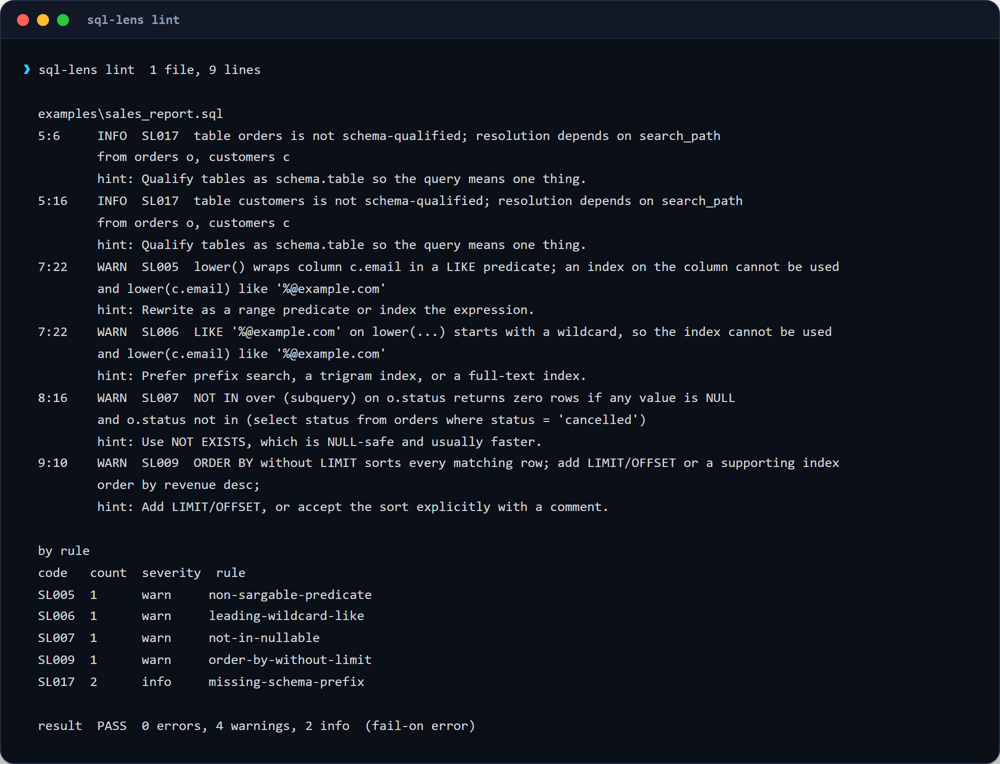
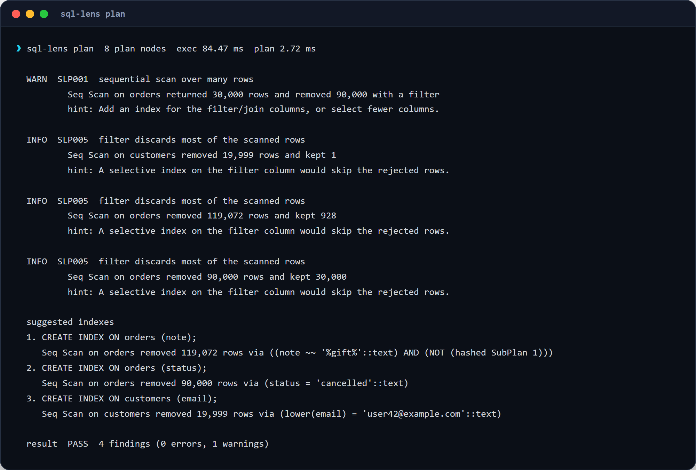
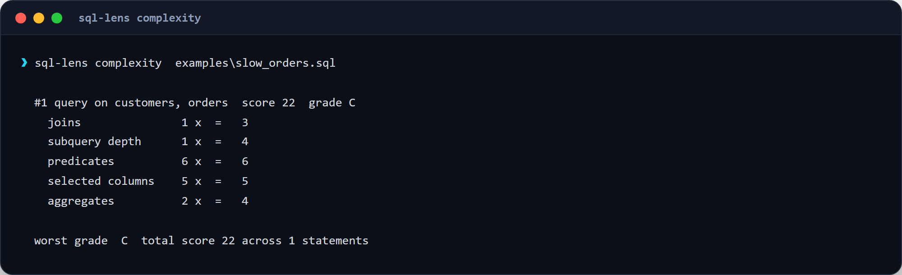
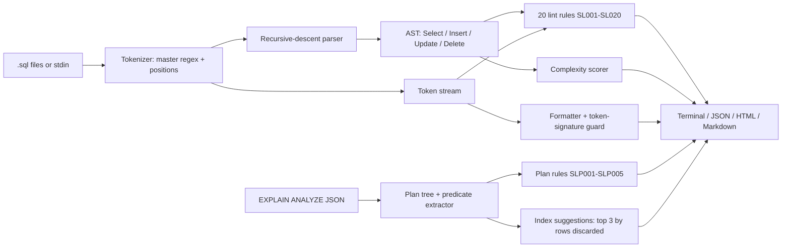

# sql-lens

[English](README.md) | **简体中文**

针对 SQL 的静态分析：在慢的、不安全的、难以维护的查询**进入生产环境之前**就把它们找出来——而且永远不需要数据库连接。




## 问题

在大多数团队里，SQL 是唯一一种在发布前从未经过一道真正能看见它的评审的代码。一次重构让 `DELETE` 丢掉了 `WHERE`，整张表就跟着一起没了。`WHERE lower(email) = $1` 会在无人察觉的情况下废掉整条登录链路所依赖的唯一索引。`NOT IN (SELECT ...)` 会在某个可空列出现的那一天开始返回零行。这些都不是语法错误，所以编译器、ORM 和测试全都保持沉默，直到生产环境不再沉默为止。

能抓住这类问题的数据库静态检查器需要一台运行中的服务器、一份模式（schema）转储，再加上半个下午的配置——于是它们被排除在 CI 之外。sql-lens 押的是另一个方向：**自己解析 SQL，把查询规划器的规则建模进去，所有检查都静态完成。** 没有连接串，没有 schema，没有副作用。20 条规则、一个真正能读 EXPLAIN 计划的解析器、一个确定性的格式化器和一个复杂度评分，全都装进一条仅用标准库的命令里。

## 它能做什么

- **20 条带稳定规则码（SL001-SL020）的静态检查规则**，覆盖正确性（不带 `WHERE` 的 `DELETE`）、性能（不可走索引的谓词、前导通配符 `LIKE`、对可空列使用 `NOT IN`、笛卡尔积、无界 `ORDER BY`）与可维护性（未被引用的 CTE、DML 中硬编码的字面量、关键字大小写混用、多余的尾逗号）。每条发现都带文件名、行号、列号、出问题的那一行源码和一条修复提示。
- **从零手写的解析器**——分词器加递归下降解析器——覆盖一个实用的 SQL 子集：`SELECT`/`INSERT`/`UPDATE`/`DELETE`、CTE（含 `RECURSIVE`）、连接、子查询、集合运算、窗口函数、`CASE`、类型转换、占位符。DDL 会保留成 token 流，所以与迁移相关的规则照样能工作。
- **五种方言**：PostgreSQL、MySQL、SQLite、SQL Server 和 ANSI，各自带真实的引用规则（双引号、反引号、`[方括号]`）、`LIMIT` 与 `TOP` 与 `FETCH FIRST` 的差别、`LIMIT` 的 offset-count 写法、`::` 类型转换、`ILIKE`、美元引用字符串（dollar-quoted string）以及嵌套块注释。
- **EXPLAIN 计划诊断**——把 `EXPLAIN (ANALYZE, FORMAT JSON)` 产出的 JSON 喂给它，它会报告大表上的顺序扫描、行数巨大的嵌套循环、偏差超过 100 倍的行数估算，以及溢写到磁盘的排序。随后它打印出从计划自身的过滤与连接谓词推导出的 **前 3 条 `CREATE INDEX` 语句**，并按每个过滤条件丢弃了多少行来排序。
- **一个确定性的格式化器**，只有一种固定风格：关键字大写、每行一个子句、`AND`/`OR` 放在行首、每个连接单独成行。它会重新分词自己的输出，并且**拒绝写出任何 token 流发生变化的文件**，所以它永远不会悄悄改坏一条查询。`format(format(x)) == format(x)` 由测试在每个自带示例上强制执行。
- **逐语句的复杂度评分**——连接数、子查询深度、CTE 数量、谓词数量、聚合函数、窗口函数——映射成 A-F 的可维护性等级，并给出每个信号的明细。
- **三种报告格式**：彩色终端输出、给工具链用的 `--format json`、可作为构建产物归档的自包含 `--format html`，另外还有用于 PR 评论的 Markdown 表格。
- **有文档的退出码**：0 表示干净，1 表示存在达到或超过 `--fail-on` 阈值的发现，2 表示用法错误。写坏的 SQL 会作为带行号和列号的解析错误报告，绝不会是一个 traceback。

## 安装

sql-lens **还没有发布到 PyPI**。从源码安装，大约十秒钟就能完成：

```bash
git clone https://github.com/kele-tao/sql-lens
cd sql-lens
python -m pip install -e .
```

需要 Python 3.10 或更高版本。**零运行时依赖**——所有东西（分词器、解析器、计划分析、HTML 渲染、终端配色）都来自标准库。`[dev]` extra 只额外引入 pytest 和 ruff。

或者不安装，直接运行：

```bash
python -m sql_lens lint examples/sales_report.sql
```

## 用法

### 1. 检查一个目录下的查询

```bash
$ sql-lens lint examples/sales_report.sql
sql-lens lint  1 file, 9 lines

  examples/sales_report.sql
  5:6     INFO  SL017  table orders is not schema-qualified; resolution depends on search_path
          from orders o, customers c
          hint: Qualify tables as schema.table so the query means one thing.
  7:22    WARN  SL005  lower() wraps column c.email in a LIKE predicate; an index on the column cannot be used
          and lower(c.email) like '%@example.com'
          hint: Rewrite as a range predicate or index the expression.
  7:22    WARN  SL006  LIKE '%@example.com' on lower(...) starts with a wildcard, so the index cannot be used
          hint: Prefer prefix search, a trigram index, or a full-text index.
  8:16    WARN  SL007  NOT IN over (subquery) on o.status returns zero rows if any value is NULL
          hint: Use NOT EXISTS, which is NULL-safe and usually faster.
  9:10    WARN  SL009  ORDER BY without LIMIT sorts every matching row; add LIMIT/OFFSET or a supporting index
          hint: Add LIMIT/OFFSET, or accept the sort explicitly with a comment.

  by rule
  code   count  severity  rule
  SL005  1      warn     non-sargable-predicate
  SL006  1      warn     leading-wildcard-like
  SL007  1      warn     not-in-nullable
  SL009  1      warn     order-by-without-limit
  SL017  2      info     missing-schema-prefix

  result  PASS  0 errors, 4 warnings, 2 info  (fail-on error)
```

把仓库里所有示例都检查一遍，这道门禁就会失败，因为其中一个犯了 `DELETE` 那一类的错误：

```bash
$ sql-lens lint examples/*.sql
...
  code   count  severity  rule
  SL002  1      error    missing-where-dml
  SL005  2      warn     non-sargable-predicate
  SL006  2      warn     leading-wildcard-like
  SL007  2      warn     not-in-nullable
  SL009  3      warn     order-by-without-limit
  SL013  1      warn     correlated-subquery
  SL015  2      warn     ddl-without-if-exists
  SL016  1      warn     unsafe-column-type-change
  SL017  4      info     missing-schema-prefix

  result  FAIL  1 error, 13 warnings, 4 info  (fail-on error)
$ echo $?
1
```

常用参数：`--dialect {postgres,mysql,sqlite,sqlserver,ansi}`、`--select SL005 SL007`、`--ignore SL017`、`--min-severity warning`、`--fail-on warning`、`--format {text,json,html,markdown}`、`-o report.html`、`--stdin`、`--no-color`。

### 2. 诊断真实的查询计划

这条查询在 [examples/slow_orders.sql](examples/slow_orders.sql) 里，[examples/explain_orders.json](examples/explain_orders.json) 中的计划是从一台真实的 PostgreSQL 实例上采集的（120,000 条 orders、20,000 条 customers），采集脚本是 [benchmarks/make_plan_fixture.py](benchmarks/make_plan_fixture.py)。分析它不需要任何数据库：

```bash
$ sql-lens plan examples/explain_orders.json
sql-lens plan  8 plan nodes  exec 84.47 ms  plan 2.72 ms

  WARN  SLP001  sequential scan over many rows
          Seq Scan on orders returned 30,000 rows and removed 90,000 with a filter
          hint: Add an index for the filter/join columns, or select fewer columns.

  INFO  SLP005  filter discards most of the scanned rows
          Seq Scan on customers removed 19,999 rows and kept 1
          hint: A selective index on the filter column would skip the rejected rows.

  INFO  SLP005  filter discards most of the scanned rows
          Seq Scan on orders removed 119,072 rows and kept 928
          hint: A selective index on the filter column would skip the rejected rows.

  suggested indexes
  1. CREATE INDEX ON orders (note);
     Seq Scan on orders removed 119,072 rows via ((note ~~ '%gift%'::text) AND (NOT (hashed SubPlan 1)))
  2. CREATE INDEX ON orders (status);
     Seq Scan on orders removed 90,000 rows via (status = 'cancelled'::text)
  3. CREATE INDEX ON customers (email);
     Seq Scan on customers removed 19,999 rows via (lower(email) = 'user42@example.com'::text)

  result  PASS  4 findings (0 errors, 1 warnings)
```



按 PostgreSQL 期望的方式采集计划：

```bash
psql -A -t -c "EXPLAIN (ANALYZE, FORMAT JSON) SELECT ..." > plan.json
sql-lens plan plan.json --format json
```

`--large-rows N` 用来调整多大的顺序扫描才算“大”（默认 5000）；`--fail-on-any` 会把任何发现都变成退出码 1，方便 CI 使用。

### 3. 格式化与评分

```bash
$ sql-lens format examples/sales_report.sql
-- Monthly revenue by country, used by the finance dashboard.
SELECT
  c.country,
  count(o.id) AS orders,
  sum(o.total_cents) AS revenue
FROM orders o, customers c
WHERE o.customer_id = c.id
  AND lower(c.email) LIKE '%@example.com'
  AND o.status NOT IN (
    SELECT status
    FROM orders
    WHERE status = 'cancelled'
  )
ORDER BY revenue DESC;
```

`sql-lens format --check examples/` 是一道 CI 门禁；`--write` 会就地把结果写回文件。然后衡量这条查询有多难维护：

```bash
$ sql-lens complexity examples/slow_orders.sql
sql-lens complexity  examples/slow_orders.sql

  #1 query on customers, orders  score 22  grade C
    joins               1 x  =   3
    subquery depth      1 x  =   4
    predicates          6 x  =   6
    selected columns    5 x  =   5
    aggregates          2 x  =   4

  worst grade  C  total score 22 across 1 statements
```



`--max-grade B` 会在某条查询的等级差于 B 时让构建失败。`sql-lens rules` 打印完整的规则参考；`sql-lens dialects` 展示每种方言各自改了什么。

## 工作原理



**只分词一次，之后每个环节都是对树的遍历。** 分词器为每种方言编译一条主正则表达式，于是扫描过程发生在 CPython 的 C 层正则引擎里；它会为每个 token 记录行号、列号、引用风格，以及该 token 前面是否紧跟着换行。这一份 token 列表供给三个使用方：解析器（产出 AST）、token 级规则（关键字大小写混用、尾逗号——这些正是语法树会归一化掉的东西）以及格式化器。位置信息贯穿整条流水线，这也是为什么每条发现都能打印出 7:22 这样的坐标和精确的源码行。

**规则是普通函数，不是 visitor 框架。** 每条规则接收一个 FileContext 并产出 Finding 对象；它们既不碰文件系统，彼此之间也不互相调用。那些需要 schema 才能回答的问题——“这一列建了索引吗？”“这一列可空吗？”——被写成标记*模式*并解释风险，而不是假装知道你的 DDL。这是一处刻意的局限，下文的规则参考表里逐条做了说明。

**计划分析器读的是 PostgreSQL 实际观测到的数据，而不是它猜出来的数字。** `EXPLAIN (ANALYZE)` 会为每个节点同时报告计划行数和实际行数，所以 sql-lens 能算出真实的估算误差，并定位到规划器的模型在哪个节点上失效。索引建议来自计划自身的 Filter、Index Cond 和 Hash Cond 字符串：用一小组模式抽出列名，按 Rows Removed by Filter 排序，最后输出成审查者可以直接复制进迁移脚本的 `CREATE INDEX` DDL——也可以直接否掉，因为遇到不可走索引的谓词（`lower(email) = ...`）时，直观的索引恰恰是错误的修法。

## 设计取舍

**1. 手写解析器，而不是引入 sqlglot 或 sqlparse。** 加一个依赖能免费换来更广的方言覆盖，但静态检查器需要四样通用解析器不会暴露的东西：每个节点的 token 位置、原始的引用字符、把注释保留为一等 token（格式化器要用），以及在文件最后一条语句已经写坏时仍然能*部分*分析整个文件的能力。写这套语法大约花了 1,100 行代码，并让安装保持零依赖——当这个工具的目标是在气隙（air-gapped）CI 容器里一秒之内跑完时，这一点很重要。

**2. 格式化器拒绝猜测。** 大多数格式化器拿到什么文本就重排什么文本；一旦有 bug，查询的语义就被悄悄改掉了。这一个会先重新分词自己的输出，再把 token 签名（kind + value，排除注释，关键字大小写归一）与输入比对，只要不一致就抛错，而不是写出文件。它同样拒绝格式化无法解析的 SQL。代价是某些不常见但合法的构造会让 `format` 在 lint 本可以正常检查的文件上直接报错——这是刻意偏向“停下来”，而不是“改坏”。

**3. 语法级分析，没有 schema，没有连接。** 这里的一切都可以从查询文本本身（外加可选的执行计划）判定。没有任何一条规则宣称知道你的索引，所以性能类规则描述的是*模式*及其后果，而不是断言某个索引缺失。这正是“每次提交都能跑的检查器”和“需要一台预发数据库的检查器”之间的区别：诚实、不依赖 schema 的版本才会被真正用起来。真正的索引建议来自计划分析器，因为在那里，数据库自己已经测量过代价。

## 规则参考

| 规则码 | 规则 | 严重级别 | 检查内容 |
| --- | --- | --- | --- |
| `SL001` | select-star | warning | `SELECT *` 会读取所有列，包括后来新增的列 |
| `SL002` | missing-where-dml | **error** | 不带 `WHERE` 的 `UPDATE`/`DELETE` 会重写或清空整张表 |
| `SL003` | unbounded-update | warning | 不带 `LIMIT` 的 `UPDATE`/`DELETE` 会把每一行都锁在同一个事务里 |
| `SL004` | implicit-cross-join | **error** | 不带 `ON`/`USING` 的 `JOIN` 会产生笛卡尔积 |
| `SL005` | non-sargable-predicate | warning | 函数包住了建索引的列（`lower(email) = $1`），任何索引都用不上 |
| `SL006` | leading-wildcard-like | warning | `LIKE '%son'` 无法使用 B-tree 索引 |
| `SL007` | not-in-nullable | warning | 只要有一个值为 `NULL`，`NOT IN (SELECT ...)` 就返回零行 |
| `SL008` | or-in-join | warning | `JOIN` 条件里的 `OR` 会让哈希连接和合并连接失效 |
| `SL009` | order-by-without-limit | warning | 不带 `LIMIT` 的 `ORDER BY` 会对整个结果集排序 |
| `SL010` | cartesian-risk | **error** | 用逗号连接、彼此之间没有任何谓词的表 |
| `SL011` | redundant-distinct | info | `DISTINCT` 与 `GROUP BY` 同时出现不可能改变结果 |
| `SL012` | unused-cte | warning | 定义了却从未被引用的 CTE |
| `SL013` | correlated-subquery | warning | 子查询读取了外层列，因此每处理一行外层数据就要执行一次 |
| `SL014` | hardcoded-literals-dml | info | DML 中本应作为绑定参数传入的字面量 |
| `SL015` | ddl-without-if-exists | warning | 不带 `IF [NOT] EXISTS` 的 `CREATE`/`DROP` 在重跑时会失败 |
| `SL016` | unsafe-column-type-change | warning | `ALTER COLUMN ... TYPE` 会在强锁下重写整张表 |
| `SL017` | missing-schema-prefix | info | 未限定表名的解析结果取决于 `search_path` |
| `SL018` | reserved-word-identifier | warning | 把保留字当作裸标识符使用 |
| `SL019` | mixed-case-keywords | info | 同一个文件里的关键字使用了不止一种大小写风格 |
| `SL020` | trailing-comma | warning | 出现在子句边界之前的逗号 |

计划规则码：SLP001 大范围顺序扫描、SLP002 结果集很大的嵌套循环、SLP003 行数估算偏差超过 100 倍、SLP004 排序或哈希溢写到磁盘、SLP005 过滤条件丢弃了绝大多数被扫描的行。

## 性能

由 `python benchmarks/run.py` 生成（提交为 [benchmarks/RESULTS.md](benchmarks/RESULTS.md) 和 [benchmarks/results.json](benchmarks/results.json)）；工作负载由固定种子生成、是确定性的，每一行是在 Windows 11、Python 3.12.10 上两次实际耗时运行中较好的那一次：

| 输入 | 语句数 | 发现数 | 检查耗时 | 检查吞吐 MB/s | 格式化耗时 | 格式化吞吐 MB/s | 复杂度耗时 | 幂等 |
| --- | --- | --- | --- | --- | --- | --- | --- | --- |
| 100 KB | 523 | 1,439 | 0.130 s | 0.8 | 0.281 s | 0.3 | 0.111 s | 是 |
| 500 KB | 2,615 | 7,192 | 0.669 s | 0.7 | 1.624 s | 0.3 | 0.697 s | 是 |
| 1 MB | 5,354 | 14,725 | 2.845 s | 0.4 | 6.520 s | 0.1 | 2.596 s | 是 |

诚实地读这张表：检查耗时是线性扩展的，几秒钟就能处理一兆字节的 SQL，对于跑在迁移目录上的 CI 门禁来说足够了——但它目前**还**不是一个能处理 5 MB 的工具。（在繁忙的笔记本上，实际耗时在两次运行之间可能相差约 30%；请在你自己的机器上重跑 `python benchmarks/run.py`，而不是把这张表的数字信到三位有效数字的程度。）格式化是最慢的一遍，因为它要校验自己的输出；而在大量小语句的场景下，每条语句的耗时里很大一部分是固定开销。缩小这个差距是路线图上的第一项。

## 对比

| | sql-lens | [sqlfluff](https://github.com/sqlfluff/sqlfluff) | [pganalyze](https://pganalyze.com/) 索引顾问 | [sqlparse](https://github.com/andialbrecht/sqlparse) |
| --- | --- | --- | --- | --- |
| 需要数据库 | 否 | 否 | **是**（计划 + schema） | 否 |
| 侧重点 | 正确性与规划器规则检查、读取执行计划 | 风格 + 方言覆盖 | 基于真实计划的索引建议 | 分词 / 切分 |
| 规则 | 20 条稳定规则码，按严重级别分档 | 约 60 条检查规则，支持插件 | 索引建议 | 无 |
| 读取 `EXPLAIN ANALYZE` JSON | **是**，并给出索引 DDL | 否 | 是（托管服务） | 否 |
| 格式化器 | 固定风格，带 token 签名护栏 | 多种风格，Jinja 模板 | 不适用 | 无 |
| 运行时依赖 | **0** | 若干 | 托管服务 | 0 |
| 在这些方面强于 sql-lens | - | 方言广度、模板化 SQL、自动修复 | 完整工作负载 + schema 知识 | 原始 SQL 切分 |

sql-lens 并不试图成为通用方言解析器：它支持上面那五种方言和前面列出的那些构造，落在这个子集之外的查询会被报告为带位置的解析错误，而不是被悄悄忽略。如果你在用 dbt 或 Jinja 模板，sqlfluff 是更合适的工具。

## 路线图

1. **大文件的吞吐**——按内容哈希缓存已解析的语句，让同一进程内重复的检查接近瞬时，同时剖析格式化器的校验阶段。路线图目标是 3 秒内处理 5 MB；目前检查 1 MB 大约需要 2.8 秒，格式化需要 6.5 秒。
2. **可选的 schema 感知模式**——接受由 information_schema 生成的 schema.json（表、列、索引、可空性），把 SL005/SL007/SL009 从模式告警升级成确定的结论，而全程不连接数据库。
3. **为安全规则提供 `--fix`**——SL001（按 schema 展开 `SELECT *`）、SL015（补上 `IF NOT EXISTS`）、SL020（删掉尾逗号）；其余规则出于设计保持只报告。
4. **更多计划形态**——识别 CTE 物化方式的选择、并行 worker 倾斜（parallel-worker skew）、分区裁剪失败，以及 Bitmap Heap Scan 的回查开销。
5. **pre-commit 钩子与 GitHub Action**——发布一个 sql-lens action，把发现标注到 PR diff 上精确的改动行。

不打算做：查询改写器、完整的 SQL 方言语法，以及任何需要实时连接的东西。那些是别的产品。

## 参与贡献

欢迎提 issue 和 pull request。这里真正有用的贡献形态是狭窄且可测试的：

- **新增一条规则**：在 [src/sql_lens/lint.py](src/sql_lens/lint.py) 的 `RULES` 里加上元数据，取下一个空闲的 SL0xx 规则码，把规则函数写在其他规则旁边，再补一个在坏写法上失败、在改正后通过的测试。规则永远不需要数据库。
- **解析器的缺口**：把它缩减成五行查询，加进 [tests/test_parser.py](tests/test_parser.py)，然后修改语法。无法支持的构造应该带位置抛出 `ParseError`，绝不能被悄悄跳过。

```bash
python -m pip install -e ".[dev]"
python -m pytest -q          # 198 tests, no network, about 1 s
python -m ruff check .       # must be clean
python benchmarks/run.py     # refresh the numbers in this README if you touch the hot path
```

规则码是永久的：一个 SL0xx 规则码永远不会改变含义。发现是确定性的——同样的输入，同样的输出，逐字节一致。

## 许可证

MIT。见 [LICENSE](LICENSE)。
